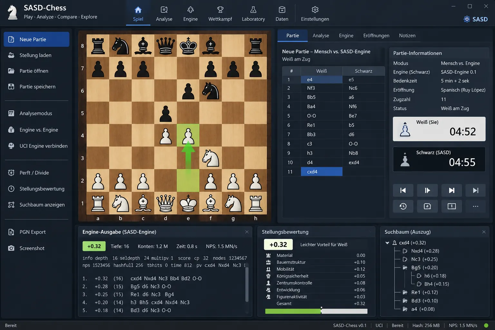

# ♞ SASD-Chess

**Ein klassisches Schachprogramm in C++ – modular, portabel, nachvollziehbar und wissenschaftlich untersuchbar.**

SASD-Chess ist ein öffentlich entwickeltes, unter der [MIT-Lizenz](LICENSE) veröffentlichtes Softwareprojekt. Geplant sind eine eigenständige Desktop-Anwendung, ein vollständiger Regelkern für Standardschach, eine selbst entwickelte **klassische** Schach-Engine und standardisierte Schnittstellen zu anderen Schachprogrammen.

Das Projekt legt besonderen Wert auf **korrekte Schachregeln, verständlichen und ausführlich dokumentierten C++-Code, klare Modulgrenzen, automatisierte Tests und reproduzierbare Experimente**. Eine lernende oder neuronal trainierte Engine ist **nicht** Gegenstand dieses Projekts.

> [!IMPORTANT]
> **Projektstand: Planung und Dokumentation (27. Oktober 2026).** Lastenheft, Pflichtenheft, Architektur, Roadmap und Entwicklungsregeln sind ausgearbeitet. **Eine fertig spielbare Anwendung, ein fertiger UCI-Engine-Prozess und installierbare Programmdateien sind derzeit nicht vorhanden.** Alle nachfolgenden Funktionsbeschreibungen und Kommandozeilenbeispiele sind als **geplante Eigenschaften** zu verstehen, sofern nichts anderes ausdrücklich angegeben ist.

---

## 🖼️ Einblick in die geplante Anwendung

<p align="center">
  
</p>

<p align="center"><strong>SASD-Chess – grafisches Oberflächenkonzept</strong></p>

> **Designstudie, kein Screenshot einer bereits laufenden Anwendung.** Die Abbildung wurde als Visualisierung der gewünschten Benutzeroberfläche erzeugt. Schachstellungen, Zugfolgen, Zahlen und Beschriftungen sind **illustrativ** und nicht als regelgeprüfte Partie, implementierte UI-Funktion oder reale Benchmarkmessung zu verstehen. Das endgültige Erscheinungsbild kann sich während der Entwicklung verändern.

Die Darstellung zeigt, wie sich das eigentliche **Schachspiel** mit späteren Bereichen für **Analyse**, **Engine-Vergleiche** und das **SASD-Chess Laboratory** verbinden könnte, ohne die klassische Spielbedienung zu überladen.

## Inhalt

- [Projektziele](#projektziele)
- [Geplante Funktionen](#geplante-funktionen)
- [Spielmodi und UCI-Interoperabilität](#spielmodi-und-uci-interoperabilität)
- [Softwarearchitektur](#softwarearchitektur)
- [Science: SASD-Chess Laboratory](#science-sasd-chess-laboratory)
- [Technologie und Plattformen](#technologie-und-plattformen)
- [Build, Tests und geplante Aufrufe](#build-tests-und-geplante-aufrufe)
- [Qualitätssicherung](#qualitätssicherung)
- [Roadmap](#roadmap)
- [Dokumentation](#dokumentation)
- [Mitwirken](#mitwirken)
- [Lizenz und rechtliche Hinweise](#lizenz-und-rechtliche-hinweise)

## Projektziele

SASD-Chess soll eine **vollständig lokal nutzbare Schachanwendung** werden, die nicht von Cloud-Diensten, Benutzerkonten oder einer Internetverbindung abhängt.

Vier Ziele bestimmen die Entwicklung:

1. **Regelkorrektheit:** Standardschach einschließlich Sonderzügen, Schachmatt, Patt, relevanten Remisregeln und nachvollziehbarer Partiehistorie.
2. **Eigenständige Spielstrategie:** Eine klassische Such-Engine, die legale Züge mit explizit programmierten Bewertungen und Spielbaumsuche ermittelt.
3. **Interoperabilität:** Das Programm soll sowohl **als UCI-Engine** verwendet werden können als auch **andere UCI-Engines selbst steuern**.
4. **Nachvollziehbarkeit:** Eine Architektur, deren Algorithmen, Testergebnisse und spätere Verbesserungen unabhängig geprüft und reproduziert werden können.

**Wichtige Abgrenzungen:** Keine zugesagte Elo-Spielstärke, kein Ersatz für etablierte Spitzenschach-Engines, kein verpflichtender Onlineservice und keine generische Brettspielplattform. Unterstützt wird zunächst **orthodoxes Standardschach**, nicht Chess960 oder andere Varianten.

## Geplante Funktionen

Die Kürzel **M**, **S** und **Z** entsprechen der Planung im Lastenheft: **Muss für Version 1.0**, **Soll**, **spätere Ausbaustufe**.

| Bereich | Geplanter Umfang | Einstufung |
| --- | --- | :---: |
| Schachbrett und Regelkern | Standardaufstellung, legale Figurenbewegung, Königssicherheit, Rochade, En passant, vier Umwandlungen | M |
| Partie | Zugrecht, Verlauf, Zurücknehmen, Matt, Patt, Remisansprüche und automatische Remisfälle | M |
| Desktop-Bedienung | Brett, Figuren, Zugliste, neue Partie, Auswahl von Start-/Zielfeld und Umwandlungsfigur | M |
| Spiel gegen Menschen | Zwei Menschen am selben Rechner | M |
| Eigener Computergegner | Klassische Positionsbewertung, Negamax/Alpha-Beta und begrenzbare Suche | M |
| FEN | Positionen importieren und exportieren, ungültige Eingaben verlässlich zurückweisen | M |
| SAN und PGN | Züge in Standardnotation darstellen, Partien als PGN exportieren | M |
| UCI-Engine | Eigene Engine als headless UCI-Programm bereitstellen | M |
| Fremde UCI-Engines | Andere Programme über eigene UCI-Client-Prozesse steuern | M |
| Automatische Engine-Partien | Eigenständiger Match-Controller, unabhängige Prozesse, Zeit-/Tiefenlimits und PGN-Protokollierung | M |
| Perft/Divide | Korrektheits- und Diagnosewerkzeuge für die Zugerzeugung | M |
| Erweiterte Bedienung | Brett drehen, Tastaturbedienung, Zusatzmarkierungen und Komfortfunktionen | S |
| PGN-Import und Analyse | Partien laden und später Zug für Zug analysieren | S |
| Benchmarks und Diagnose | Suchknoten, Tiefe, Laufzeit, Bewertungsaufschlüsselung und weitere Suchmetriken | S |
| Laboratory | Experimentverwaltung, Algorithmenvergleiche, Suchbaumvisualisierung und Forschungsberichte | Z |

**Prioritäten gelten für die Umsetzung, nicht als Aussage über den aktuellen Fertigstellungsgrad.** Manche Soll-Funktionen sind vom Abschluss früherer Meilensteine abhängig.

## Spielmodi und UCI-Interoperabilität

### Spielen

Geplant sind mindestens **Mensch gegen Mensch** und **Mensch gegen SASD-Chess**. Die menschliche Farbe soll wählbar sein. Partieaktionen werden stets vom zentralen Regelkern überprüft, nicht von der grafischen Oberfläche.

### Zwei Schachprogramme gegeneinander

Ein zentrales Entwicklungsziel ist der ausdrücklich geforderte Modus **Engine gegen Engine**:

- **SASD-Chess gegen SASD-Chess:** Zwei unabhängig gestartete Instanzen derselben ausführbaren Engine-Datei spielen gegeneinander.
- **SASD-Chess gegen Fremdengine:** Eine eigene und eine andere UCI-konforme Engine treten gegeneinander an.
- **Fremdengine gegen Fremdengine:** Der neutrale Match-Controller kann perspektivisch auch zwei externe UCI-Programme gegeneinander steuern.

```text
                 SASD-Chess Match-Controller
                (eigenständiger Schiedsrichter)
                             |
                  Autoritatives Chess Game
                 (Zugrecht, Legalität, Ergebnis)
                             |
                +------------+------------+
                |                         |
           UCI-Client A              UCI-Client B
                |                         |
         stdin / stdout            stdin / stdout
                |                         |
         Engine-Prozess A          Engine-Prozess B
          (Weiß oder Schwarz)       (Schwarz oder Weiß)
```

**Wesentlich:** Die beiden Engines sprechen **nicht direkt miteinander**. Der Match-Controller führt die Partie, sendet den jeweiligen Suchauftrag und kontrolliert jeden gemeldeten `bestmove` anhand des unabhängigen Schachkerns. Ein fehlerhafter Zug, ein Prozessabsturz oder eine Zeitüberschreitung darf keinen ungültigen Spielstand erzeugen.

### Geplante UCI-Grundfunktionen

Die eigene Engine soll insbesondere `uci`, `isready`, `ucinewgame`, `position startpos`, `position fen ...`, `go depth`, `go movetime`, die grundlegenden Uhrparameter, `stop` und `quit` verarbeiten und `bestmove` ausgeben können.

Die Prozesskommunikation verwendet **stdin/stdout**, Diagnosemeldungen gehören nach **stderr**. Für ein Match dürfen zwei Prozesse weder ihren Brettzustand noch ihren Suchspeicher miteinander teilen.

UCI, PGN und FEN sind bewährte Austauschformate; sie werden als **Schnittstellen**, nicht als Ersatz für den internen Partie- und Zustandskern behandelt.

## Softwarearchitektur

SASD-Chess wird als **modularer C++-Monorepo** mit klarer Abhängigkeitsrichtung entworfen. Die Komponenten sollen ohne unnötig enge Kopplung entwickelt und unabhängig getestet werden können.

| Modul | Verantwortung |
| --- | --- |
| `chess-core` | Figuren, Felder, Stellung, Attacken, legale Züge, reversibles `make/unmake`, Perft |
| `chess-game` | Partieverlauf, Wiederholung, Remisansprüche, Ergebnisse, Undo |
| `chess-formats` | FEN, SAN, PGN und Zugnotationskonvertierung |
| `chess-search` | Klassische Bewertung und Spielbaumsuche mit Abbruch und Limits |
| `chess-uci-protocol` / `chess-uci-host` | Protokolltypen und eigener UCI-Engine-Prozess |
| `chess-process` / `chess-uci-client` | Sichere Prozessstarts, Pipes, Zeitgrenzen, UCI-Sitzungen |
| `chess-match` | Autoritative Engine-Matches, Schachuhr und PGN-Protokollierung |
| `chess-application` / `chess-desktop` | Anwendungsfälle, UI-Snapshots und grafische Darstellung |
| `chess-diagnostics` / `chess-benchmark` | Optionale Messungen und reproduzierbare Testläufe |
| `chess-laboratory` | Spätere schachbezogene Versuchsdurchführung und Auswertung |

### Architekturgrundsätze

**Eine schachliche Wahrheit:** Zuglegalität wird nicht getrennt in GUI, Suche, UCI und Match-Controller implementiert.

**Fachlich getrennte Zustände:** Eine **Position** beschreibt eine aktuelle Brettstellung. Ein **Game** ergänzt Partiehistorie und Ergebnisse. Ein **SearchState** gehört ausschließlich zu einer vorübergehenden Suchberechnung. Eine einzelne FEN-Stellung ersetzt keine Historie, die beispielsweise für Stellungswiederholungen nötig ist.

**Transaktionale Änderungen:** Ein illegaler Zug oder fehlerhafter Import darf einen bereits gültigen Spielstand **nicht teilweise verändern**.

**Unabhängigkeit von der Oberfläche:** Schachkern, Engine, UCI, Matches und Tests müssen **headless** baubar und nutzbar sein. Die konkrete GUI-Technologie wird anhand einer begründeten technischen Entscheidung ausgewählt.

**Korrektheit vor Optimierung:** Die erste Brettrepräsentation darf einfach und verständlich sein. Spezialisierte Bitboards, Cache-Optimierungen und andere Beschleunigungen werden anhand von Tests und Benchmarks beurteilt.

**Portabilität:** Betriebssystemabhängige Funktionen (insbesondere Kindprozesse, Pipes und UI) werden gekapselt, damit der Core unter unterschiedlichen Systemen identisch arbeiten kann.

**Kein Framework auf Vorrat:** Module und Schnittstellen entstehen schrittweise dort, wo eine echte Verantwortung oder ein nachgewiesenes Abhängigkeitsproblem besteht.

Das vollständige Architekturmodell einschließlich Zustandsautomaten, UCI-Fehlerfällen, Remisregeln, Ressourcenbesitz und ADR-Kandidaten steht in **[docs/Architektur.md](docs/Architektur.md)**.

## Science: SASD-Chess Laboratory

Der wissenschaftliche Beitrag des Projekts liegt in der **experimentellen Informatik**: Wir können klassische Suchalgorithmen systematisch untersuchen, Messungen dokumentieren und Änderungen mit reproduzierbaren Methoden bewerten.

Das geplante Laboratory ist ein **schachbezogener** Zusatzbereich, kein zweites Schachprogramm. Er verwendet dieselbe Engine und denselben geprüften Regelkern wie der Spielmodus.

### Arbeitsbereiche

| Bereich | Zweck |
| --- | --- |
| **Spielen** | Partien und Engine-Gegner |
| **Analysieren** | Stellungslabor, legale Züge, Bewertungsmerkmale, Partieanalyse |
| **Laboratory** | Benchmarkläufe, Algorithmusvergleiche, Engine-Serien, Experimente und Berichte |

### Beispiele wissenschaftlicher Fragestellungen

- Wie verändert sich die Knotenzahl bei **Negamax gegenüber Alpha-Beta-Pruning** unter derselben Suche und Suchtiefe?
- Wie stark beeinflusst die **Zugreihenfolge** die Wirksamkeit von Alpha-Beta-Pruning?
- Welche Unterschiede ergeben sich zwischen **Brettrepräsentationen** bei gleichen legalen Zügen?
- Bringt eine veränderte **heuristische Bewertung** unter identischen Zeitbedingungen nachweisbare Vorteile in Engine-Vergleichspartien?
- Welche Fehler in der Zugerzeugung finden **Unit-Tests, Perft, Divide und Eigenschaftstests**?

Messungen sollen Stellung/FEN, Engine- und Git-Version, Compiler, Buildkonfiguration, Suchlimits, Laufzeit, Knoten und – soweit möglich – die verwendete Hardware dokumentieren. Engine-Serien sollen Farben und Eröffnungsstellungen systematisch ausgleichen sowie statistische Unsicherheit kenntlich machen.

> **Methodischer Grundsatz:** Mehr Knoten pro Sekunde bedeuten nicht automatisch bessere Züge. Weniger Suchknoten bedeuten nicht automatisch höhere Spielstärke. Eine einzelne gewonnene Partie ist kein wissenschaftlicher Beweis für eine verbesserte Engine.

Die Laboratory-Funktionen werden in den Stufen **L1–L3** geplant. **Perft/Divide** gehört dagegen bereits zur Pflicht-Qualitätssicherung des Schachkerns.

## Technologie und Plattformen

| Thema | Geplante Festlegung bzw. aktueller Stand |
| --- | --- |
| Programmiersprache | **C++20** |
| Buildsystem | **CMake** |
| Testintegration | **CTest**, zusätzliches Testframework noch auszuwählen |
| Plattformen für die erste Zielversion | **Windows und Linux** |
| Weitere denkbare Plattformen | BSD und macOS, abhängig von Technik und Testinfrastruktur |
| GUI-Framework | **Noch offen**; mögliche Kandidaten werden in einem separaten Spike/ADR bewertet |
| Netzwerk / Konten / Cloud | Für das normale Programm **nicht erforderlich** |
| Lizenz | **MIT**, siehe [LICENSE](LICENSE) |
| Versionsstand der Software | **Noch keine spielbare Version veröffentlicht** |

Der konkrete GUI-Adapter und die Compiler-/Buildmatrix werden durch Tests bestätigt, nicht durch bloße Planung.

## Build, Tests und geplante Aufrufe

### Aktueller Stand

Es gibt **noch keinen fertig eingerichteten CMake-Build und keine installierbare Anwendung**. Die folgenden Befehle zeigen den **vorgesehenen Ablauf nach Meilenstein M0**, nicht einen heute bereits erfolgreich ausführbaren Build.

### Vorgesehener Linux-Build

```bash
git clone https://github.com/Robin-Goerlach/SASD-Chess.git
cd SASD-Chess

cmake -S . -B build -DCMAKE_BUILD_TYPE=Debug
cmake --build build
ctest --test-dir build --output-on-failure
```

### Vorgesehener Windows-Build

In einer passenden Visual-Studio-Developer-PowerShell mit CMake und MSVC:

```powershell
git clone https://github.com/Robin-Goerlach/SASD-Chess.git
cd SASD-Chess

cmake -S . -B build
cmake --build build --config Debug
ctest --test-dir build --config Debug --output-on-failure
```

Die konkreten Mindestversionen und tatsächlichen Buildoptionen werden **erst nach erfolgreicher M0-Implementierung** festgeschrieben. Zusätzliche Hinweise bietet **[docs/DEVELOPMENT.md](docs/DEVELOPMENT.md)**.

### Vorgesehene Engine-/Match-Kommandos

Die folgende CLI ist **illustrativ und noch nicht implementiert**; ihre endgültige Syntax wird in einem späteren Meilenstein festgelegt:

```bash
# Zwei eigenständige Prozesse derselben Engine:
sasd-chess-match --white ./sasd-chess-uci --black ./sasd-chess-uci --depth 6 --pgn selfplay.pgn

# Eigenes Programm gegen eine andere UCI-Engine:
sasd-chess-match --white ./sasd-chess-uci --black ./other-uci-engine --movetime 1000 --pgn match.pgn
```

Damit wird die wichtigste Interoperabilitätsanforderung sichtbar: **Ein zweiter Prozess unserer eigenen Engine muss genauso als Gegner funktionieren wie eine unabhängige fremde UCI-Engine.**

## Qualitätssicherung

Die Regelkorrektheit wird insbesondere durch **Perft (Performance Test)**, **Divide** und gezielte Teststellungen überprüft. Perft zählt die legalen Zugfolgen bis zu einer bestimmten Tiefe und lässt sich mit veröffentlichten Referenzwerten vergleichen.

### Referenzwerte für die Standardanfangsstellung

| Tiefe | Korrekte Perft-Blattanzahl |
| ---: | ---: |
| 0 | 1 |
| 1 | 20 |
| 2 | 400 |
| 3 | 8.902 |
| 4 | 197.281 |
| 5 | 4.865.609 |
| 6 | 119.060.324 |

**Divide** schlüsselt diese Gesamtzahl nach jedem legalen ersten Zug auf. Die Summe der Teilzahlen muss mit dem entsprechenden Perft-Ergebnis übereinstimmen. Weitere Teststellungen prüfen unter anderem Rochade, Fesselung, En passant, Umwandlung und Schachabwehr.

Neben der Zugerzeugung benötigen wir Tests für:

- **Reversibilität:** `unmake(make(position, move))` stellt sämtliche Zustandsinformationen wieder her.
- **Partiehistorie:** Wiederholung und beanspruchbare gegenüber automatisch eintretenden Remisregeln.
- **Formate:** Gültige und ungültige FEN-/PGN-/SAN-Eingaben, Roundtrip-Tests.
- **Strategie-Engine:** Nur legale Bestmoves, feste Tiefen, Abbruch und terminale Stellungen.
- **UCI:** Handshake, genau ein Abschluss pro Suche, Protokollreinheit von stdout.
- **Match-Controller:** Fremdengine, Selbstspiel, technische Fehler, Timeouts und Prozessbereinigung.
- **Desktop:** Vollständige Partien, Promotion, Undo und nicht blockierende Engine-Suche.
- **Laboratory:** Messmetadaten, Diagnosegrenzen, Vergleichsmethodik und Berichte nach deren Implementierung.

**Perft allein beweist weder vollständige Regeltreue noch Engine-Spielstärke.** Besonders anspruchsvolle Regelbereiche wie tote Stellungen, Remisansprüche und Schachuhr-Wertungen erhalten zusätzliche fachliche Tests.

Der vollständige Prüfplan mit Abnahme-IDs **LH-A-01 bis LH-A-17** befindet sich in **[docs/TESTPLAN.md](docs/TESTPLAN.md)**.

## Roadmap

Die eigentliche Entwicklung folgt inkrementellen Meilensteinen. Jeder Meilenstein wird erst nach nachweislich erfolgreichem Build, passenden Tests und aktualisierter Dokumentation als abgeschlossen markiert.

| Phase | Inhalt | Planungsstand |
| --- | --- | --- |
| **M0** | C++20-/CMake-/CTest-Fundament, Windows-/Linux-CI | Geplant |
| **M1** | Brett, legale Züge, Sonderregeln, make/unmake und Perft/Divide | Geplant |
| **M2** | Game, Historie, Remisregeln, FEN, SAN, PGN | Geplant |
| **M3** | Klassische Engine, Negamax/Alpha-Beta, UCI-Host | Geplant |
| **M4** | UCI-Client, zwei Prozesse, Match-Controller, Selbstspiel und Fremdengine | Geplant |
| **M5** | Spielbare Desktop-Anwendung | Geplant |
| **M6** | Regressionstests, Dokumentation, Lizenz-/Assetprüfung, Release 1.0 | Geplant |
| **L1** | Stellungslabor, Bewertungsanalyse, Diagnostik und Benchmarks | Nach 1.0 geplant |
| **L2** | Engine-Serien, Statistik, Exporte und Partieanalyse | Nach 1.0 geplant |
| **L3** | Experimente, Algorithmusvergleiche, Suchtraces und Forschungsberichte | Nach 1.0 geplant |

Detaillierte Arbeitspakete, Risiken, kritischer Pfad und **Definition of Done**: **[ROADMAP.md](ROADMAP.md)**.

## Dokumentation

Die Dokumentation wird überwiegend **auf Deutsch** gepflegt; C++-Bezeichner sind zur besseren Portabilität und Lesbarkeit international verständlich gewählt.

| Dokument | Inhalt |
| --- | --- |
| [Lastenheft](docs/Lastenheft.md) | Fachliche Ziele, Muss-/Soll-/Zukunftsanforderungen und Abnahme |
| [Pflichtenheft](docs/Pflichtenheft.md) | Technische Umsetzung und Traceability |
| [Architektur](docs/Architektur.md) | Architekturprinzipien, Modul- und Prozessgrenzen, Fehler-/Zustandsverträge |
| [Roadmap](ROADMAP.md) | M0–M6, L1–L3 und Meilenstein-Gates |
| [AGENTS.md](AGENTS.md) | Verbindliche Entwicklungsleitlinien für Menschen und Coding Agents |
| [AGENT.md](AGENT.md) | Verweis auf das zentrale AGENTS.md |
| [Entwicklungshandbuch](docs/DEVELOPMENT.md) | Vorgesehene lokale Build- und Debugging-Verfahren |
| [Testplan](docs/TESTPLAN.md) | Regel-, UCI-, Match-, Desktop- und Laboratory-Prüfungen |
| [ADR-Register](docs/adr/README.md) | Architekturentscheidungen, Alternativen und Konsequenzen |
| [CONTRIBUTING.md](CONTRIBUTING.md) | Mitwirken, Code-/Review-/Testkonventionen |
| [CHANGELOG.md](CHANGELOG.md) | Dokumentierte Änderungen und spätere Release-Einträge |

Die Lasten-/Pflichtenhefte sind derzeit Entwürfe **v0.4** und das Architekturdokument **v0.2**. Einzelne offene Entscheidungen in älteren Dokumentpassagen können durch bereits erfolgte Repository-Änderungen (beispielsweise die nun vorhandene [MIT-Lizenz](LICENSE)) überholt sein und werden im Rahmen der Dokumentationspflege nachgeführt.

## Mitwirken

Beiträge zu Schachregeln, Testfällen, C++-Architektur, UCI-Interoperabilität, Portabilität und verständlicher Dokumentation sind willkommen.

Vor Änderungen bitte die **[Beitragsrichtlinien](CONTRIBUTING.md)** und **[AGENTS.md](AGENTS.md)** lesen. Für wesentliche Architekturentscheidungen verwenden wir **Architecture Decision Records (ADR)**. Neue Funktionen sollen die vorhandenen Modulgrenzen wahren und nachvollziehbare Tests besitzen.

Besonders wertvoll sind **kleine, isolierte Verbesserungen mit erklärenden Codekommentaren und aussagekräftigen Regressionstests**. Optimierungen erfolgen erst nach einer funktionierenden und messbaren Ausgangsversion.

## Lizenz und rechtliche Hinweise

**SASD-Chess steht unter der [MIT-Lizenz](LICENSE).** Maßgeblich sind die Lizenzbedingungen und der Copyright-Hinweis der im Repository vorhandenen Lizenzdatei.

Bei zukünftiger Verwendung fremder Figurenbilder, Schriften, Schach-Engines oder anderer Bibliotheken müssen deren **jeweilige Nutzungs- und Weitergaberechte** separat geprüft werden. Eine verfügbare Drittanbieter-Engine ist nicht automatisch Bestandteil dieses Repositories oder unter dessen MIT-Lizenz gestellt.

Die hier gezeigte Benutzeroberfläche ist eine **illustrative Designstudie** und enthält keine Behauptung über einen bereits existierenden produktiven Programmstand.

---

<p align="center">
  <strong>SASD-Chess</strong><br>
  <em>Klassisches Schach. Saubere Softwarearchitektur. Nachvollziehbare Informatik.</em>
</p>
